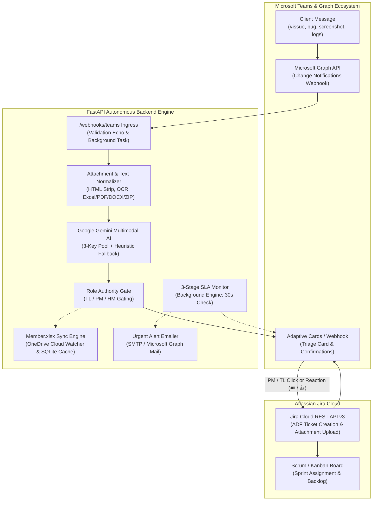
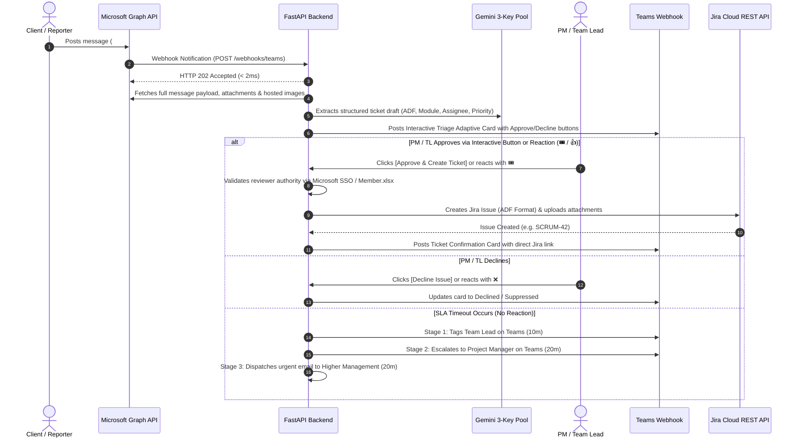
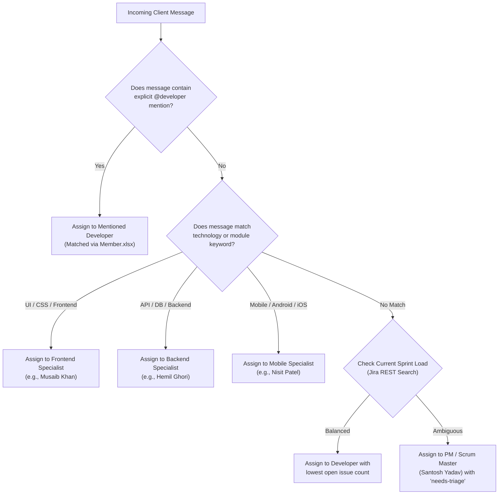

# Jira Automation Hub — Autonomous Microsoft Teams to Jira Cloud Scrum Engine

[](https://www.python.org/downloads/)
[](https://fastapi.tiangolo.com)
[](https://ai.google.dev/)
[](https://www.atlassian.com/software/jira)
[](https://learn.microsoft.com/en-us/graph/)
[](LICENSE)

An enterprise-grade, autonomous Scrum automation engine that captures bug reports, defect logs, screenshots, and task requests directly from **Microsoft Teams** group chats and channels via **Microsoft Graph Webhooks**, extracts structured Jira specifications using **Google Gemini Multimodal AI**, gates creation behind a **3-tier management authority workflow** (Team Lead, Project Manager, Higher Management), and automatically creates formatted tickets with full Atlassian Document Format (ADF) descriptions and uploaded attachments in **Atlassian Jira Cloud**.

---

## Table of Contents

1. [Executive Overview & Value Proposition](#executive-overview--value-proposition)
2. [End-to-End System Architecture](#end-to-end-system-architecture)
   - [High-Level Workflow Diagram](#high-level-workflow-diagram)
   - [Inbound Message & Triage Lifecycle](#inbound-message--triage-lifecycle)
   - [3-Stage SLA Follow-Up & Escalation Timeline](#3-stage-sla-follow-up--escalation-timeline)
   - [Smart Developer Assignment & Roster Matrix](#smart-developer-assignment--roster-matrix)
3. [Key Features & Capabilities](#key-features--capabilities)
4. [Technology Stack](#technology-stack)
5. [Project Directory Layout](#project-directory-layout)
6. [Prerequisites & System Requirements](#prerequisites--system-requirements)
7. [Step-by-Step Installation & Configuration](#step-by-step-installation--configuration)
   - [1. Environment Setup](#1-environment-setup)
   - [2. Environment Variables (.env) Reference](#2-environment-variables-env-reference)
   - [3. Member.xlsx (Single Source of Truth) Setup](#3-memberxlsx-single-source-of-truth-setup)
   - [4. Microsoft Entra ID (Azure AD) App Registration](#4-microsoft-entra-id-azure-ad-app-registration)
   - [5. Microsoft Teams Webhook Configuration](#5-microsoft-teams-webhook-configuration)
   - [6. Atlassian Jira Cloud API Configuration](#6-atlassian-jira-cloud-api-configuration)
8. [Running the Application](#running-the-application)
   - [Headless Service Mode (All-in-One Launcher)](#headless-service-mode-all-in-one-launcher)
   - [Direct Server Execution](#direct-server-execution)
9. [CLI Management & Diagnostic Utilities](#cli-management--diagnostic-utilities)
10. [Comprehensive API & Endpoint Reference](#comprehensive-api--endpoint-reference)
11. [Testing & Quality Assurance Guide](#testing--quality-assurance-guide)
12. [Troubleshooting & Solved Edge Cases](#troubleshooting--solved-edge-cases)
13. [Production Deployment & Cloud Roadmap](#production-deployment--cloud-roadmap)
14. [Financial Cost Analysis (20-Person Live Team)](#financial-cost-analysis-20-person-live-team)
15. [License](#license)

---

## Executive Overview & Value Proposition

In high-velocity software engineering projects, clients and stakeholders report bugs, paste error logs, and attach UI screenshots across busy Microsoft Teams support channels. Project Managers (PMs) and Team Leads (TLs) spend hours every week manually translating these chats into Jira tickets, transcribing steps to reproduce, downloading and re-uploading screenshots, and assigning tickets.

**Jira Automation Hub** eliminates this manual overhead completely:

* **Zero Message Loss**: Microsoft Graph change notifications listen 24/7 to client channels and group chats.
* **Multimodal Intelligence**: Google Gemini Vision & LLM analyzes formatted text, stack traces, inline screenshots, Excel logs, and Word/PDF defect specifications to construct professional Jira issue specifications.
* **Strict Human-in-the-Loop Gating**: No ticket is created without explicit authorization from an authorized Team Lead (Level 1), Project Manager (Level 2), or Higher Management (Level 3), preventing bot spam.
* **Interactive Teams Triage Cards**: Management receives an actionable Adaptive Card directly in Teams with single-click web approval, decline, and dynamic developer reassignment dropdowns.
* **3-Tier SLA Escalation**: If an incoming client issue remains unaddressed, the background SLA engine automatically sends Teams reminders to the TL, escalates to the PM, and dispatches urgent Outlook emails to Higher Management.
* **Shared Excel as SSOT**: Team rosters, developer specialties, approval permissions, and SLA timers are maintained in `Member.xlsx` (synced via OneDrive), auto-discovered by the engine with zero code edits.

---

## End-to-End System Architecture

### High-Level Workflow Diagram



---

### Inbound Message & Triage Lifecycle



---

### 3-Stage SLA Follow-Up & Escalation Timeline

```mermaid
gantt
    title Automated SLA Triage & Management Escalation Timeline
    dateFormat mm
    axisFormat %M m

    section Incident Triage
    Client Message Arrives        :milestone, m0, 00, 00
    SLA Clock Initiated           :active, a1, 00, 10
    Stage 1: TL Teams Reminder    :crit, s1, 10, 11
    Stage 2: PM Teams Escalation  :crit, s2, 20, 21
    Stage 3: HM Outlook Email     :crit, s3, 30, 31
```

* **Stage 1 (Default: 10 mins)**: If no management reaction or reply occurs within 10 minutes of a client reporting an issue, an alert card tags the **Team Lead (Level 1)** in the channel.
* **Stage 2 (Default: 20 mins)**: If silence persists for an additional 10 minutes (total 20 minutes), the engine escalates and tags the **Project Manager (Level 2)** with an urgent triage card.
* **Stage 3 (Default: 20 mins)**: If still unaddressed, an urgent branded HTML email is dispatched directly to **Higher Management (Level 3)** via SMTP or Microsoft Graph Mail.
* **Auto-Cancellation**: As soon as any authorized team member reacts with an emoji or posts a text reply, the SLA timer is immediately cancelled.

---

### Smart Developer Assignment & Roster Matrix



---

## Key Features & Capabilities

### 1. ⚡ High-Performance Microsoft Graph Webhook Engine
- **Instant Webhook Validation Challenge**: Validates incoming Microsoft Graph subscription challenges (`GET` and `POST` validation tokens) in **under 2 milliseconds**, completely eliminating the Microsoft 30-second timeout loop.
- **Asynchronous Ingress Isolation**: Immediately returns `202 Accepted` to Microsoft Graph while offloading payload retrieval, image downloads, and AI classification to background event loops.
- **Rapid Deduplication Filter**: Employs an intra-batch and cross-retry rolling window cache (4.0s window) to suppress duplicate webhook delivery pings.
- **Tenant Boundary Security**: Rejects incoming notifications originating from unauthorized Azure AD / Microsoft Entra tenants.

### 2. 🤖 Google Gemini Multimodal AI Ticket Extractor
- **Multi-Key Round-Robin & Failover Pool**: Seamlessly rotates across up to 9 Gemini API keys (`GEMINI_API_KEY_1`, `GEMINI_API_KEY_2`, `GEMINI_API_KEY_3`, `GEMINI_API_KEYS`). If Key 1 hits Google's 15 Requests Per Minute (RPM) free-tier limit (`429 RESOURCE_EXHAUSTED`), the engine fails over to Key 2 in **under 50 milliseconds**.
- **Offline Heuristic Rule Engine**: If all API keys or external internet connectivity are unavailable, an integrated rule-based fallback extracts issue summaries, steps to reproduce, priority, and assignees without dropping any client requests.
- **Multimodal Vision & Log Analysis**: Inspects attached UI screenshots, stack traces, and network error logs to extract error codes and UI defect evidence.
- **Multi-Issue Splitting**: If a client lists multiple distinct defects in a single message (e.g. `1. Login fails with 500 error; 2. Profile icon is misaligned`), Gemini separates them into individual tickets with parent reference tracking.
- **Zero-Asterisk ADF Output**: Cleans all raw markdown markers (`*`, `**`, `_`) ensuring pristine, professional Atlassian Document Format (ADF) formatting on Jira Cloud.

### 3. 📎 Multi-Format Attachment Processing
Extracts defect evidence from all major formats:
- **Images**: PNG, JPG, JPEG, WEBP, GIF (multimodal vision inspection + OCR extraction).
- **Spreadsheets**: Excel `.xlsx`, `.xlsm` (parsed via `openpyxl` into structured markdown tables).
- **Documents**: Word `.docx` (OpenXML paragraph, table, and heading extraction).
- **PDFs**: Portable Document Format `.pdf` (FlateDecode text and metadata stream extraction).
- **Archives**: `.zip` files (recursive archive inspection of nested code, crash dumps, and text logs).
- **Text & Logs**: `.log`, `.txt`, `.json`, `.csv`, `.xml`, `.sql`, `.md`, `.py`, `.js`.

### 4. 🛡️ Role Authority Gating & Management Hierarchy
- **Three-Tier Authority Levels**:
  - **Level 1 (TL - Team Lead)**: First responder; can approve or decline triage tickets.
  - **Level 2 (PM - Project Manager)**: Scrum master and primary owner for approvals and sprint assignments.
  - **Level 3 (HM - Higher Management)**: Receives SLA escalation emails; holds override approval authority.
- **Spoof-Proof Restrictions**: General developers and client accounts cannot create Jira tickets by adding reactions, preventing unauthorized ticket creation.
- **Single-User Testing Mode**: Set `ALLOW_SELF_APPROVAL=true` in `.env` to simulate PM approvals with a single testing account.

### 5. 🎛️ Interactive Microsoft Teams Adaptive Cards
- **Triage Confirmation Card**: Formatted card displaying issue summary, priority badge, module, suggested assignee, and evidence snippets.
- **1-Click Web Actions**: Action buttons `[🎟️ Approve & Create Ticket]`, `[❌ Decline Issue]`, and `[🔄 Modify / Change Assignee]`.
- **Dynamic Assignee Dropdown**: Live interactive selector allowing management to reassign the ticket to any active member from `Member.xlsx` before creation.
- **Ticket Confirmation Card**: Automatically posted to the Teams group chat upon Jira creation, featuring Ticket Key, direct Jira link, Assignee, Priority, Status, and Timestamp.
- **Reaction Emojis**: Management can simply react to the client message with `🎟️`, `🎫`, or `👍` to trigger ticket creation, or `❌` to decline.

### 6. 🎟️ Atlassian Jira Cloud REST API v3 Integration
- **Atlassian Document Format (ADF)**: Generates structured Jira v3 documents containing info callout panels, headings, step-by-step bullet lists, and source metadata.
- **Automatic Attachment Upload**: Downloads screenshots, logs, and files from Microsoft Graph and uploads them directly to the Jira ticket via multipart API.
- **Assignee Account Resolution**: Resolves team member names to Atlassian `accountId` identifiers.
- **Labels & Components**: Automatically tags tickets with `teams-automation` and assigns appropriate software components.

### 7. ⏱️ Automated 3-Stage SLA Escalation Engine
- **Background Worker**: Evaluates all pending client messages every 30 seconds.
- **Business Hours Schedule**: Respects working hours (e.g. 09:00 - 19:00), weekend exclusions, and timezone (`Asia/Kolkata`).
- **Backlog Cutoff Protection**: Suppresses alerts for historical messages older than 24 hours.
- **Reply & Reaction Detection**: Automatically halts the SLA timer the instant a team member posts a reply or adds an emoji.

### 8. 📊 Member.xlsx as the Single Source of Truth (SSOT)
- **Shared Cloud Workbook**: Maintains team identities, emails, roles, levels, specialties, and approval permissions.
- **Dynamic System Settings Tab**: Manages SLA timers, working hours, trigger keywords, and Jira defaults directly from Excel.
- **Live Teams Roster Auto-Discovery**: Automatically queries the Teams channel roster on startup, syncing new team members into `Member.xlsx`.
- **Real-Time File Watcher**: Automatically reloads configuration and updates database read-caches whenever `Member.xlsx` is edited in OneDrive.

### 9. 🔐 Microsoft 365 OAuth2 / SSO Authentication
- **Zero-Friction SSO**: Authenticates management users against Microsoft Entra ID via `/auth/login` and `/auth/callback`.
- **Tamper-Proof Session Security**: Uses HMAC-SHA256 signed session cookies (`jira_auth_session`, `jira_reviewer`) with automatic expiration.

### 10. 🚀 All-in-One Autonomous Service Runner (`py run.py`)
- **Single-Command Startup**: Starts or connects to the local ngrok tunnel, boots the FastAPI engine, creates or renews the Microsoft Graph subscription, and starts the SLA monitor in one command.
- **OneDrive Lock Conflict Shield**: Automatically relocates SQLite databases away from OneDrive synchronization paths to prevent file lock stalls (`db-shm` conflicts).

---

## Technology Stack

| Component | Technology | Version / Library | Architectural Rationale |
| :--- | :--- | :--- | :--- |
| **Runtime** | Python | `3.10+` (Tested on 3.12) | Rich ecosystem for AI, Microsoft Graph, and cloud automation |
| **Web Framework** | FastAPI | `>= 0.115.0` | Async ASGI framework with OpenAPI docs and high throughput |
| **ASGI Server** | Uvicorn | `>= 0.30.0` | Production ASGI web server supporting async event loops |
| **AI / Multimodal LLM** | Google Gemini | `google-genai >= 1.0.0` | Fast multimodal vision & text analysis (Gemini 2.5 / 3.5 Flash) |
| **Jira Cloud API** | Atlassian REST API | `v3 (ADF Format)` | Official Jira Cloud REST API for structured ticket authoring |
| **Identity & Graph Auth** | MSAL Python | `msal >= 1.31.0` | Official Microsoft Authentication Library with token caching |
| **HTTP Client** | HTTPX | `>= 0.27.0` | Async and synchronous HTTP client with connection pooling |
| **Data Validation** | Pydantic | `>= 2.8.0` | Fast typed model validation and JSON Schema generation |
| **Excel / SSOT Engine** | openpyxl | `>= 3.1.0` | Native Excel spreadsheet manipulation, styling, and parsing |
| **Image Processing** | Pillow (PIL) | `>= 10.0.0` | Image dimension extraction, format normalization, and OCR hints |
| **Local Persistence** | SQLite | Python standard `sqlite3` | Zero-configuration persistence with WAL (Write-Ahead Logging) |
| **Tunneling / Ingress** | ngrok / Cloudflare | Native binary | Secure public HTTPS ingress for local development webhooks |
| **Testing Framework** | pytest | `>= 8.0.0` | End-to-end integration and unit testing framework |

---

## Project Directory Layout

```
Jira-Automation/
├── main.py                           # Server entry point (FastAPI / Uvicorn)
├── run.py                            # Single-command launcher (Tunnel + Subscriptions + Engine)
├── requirements.txt                  # Python dependencies
├── pytest.ini                        # Pytest configuration
├── .env.example                      # Complete environment variable template
├── .gitignore                        # Git exclusion rules
│
├── src/
│   ├── app.py                        # FastAPI application setup, lifecycle & middleware
│   ├── config.py                     # Centralized environment configuration & validation
│   ├── logger.py                     # Structured colorized logging engine
│   ├── database.py                   # SQLite database initialization & OneDrive lock shield
│   ├── graph_client.py               # Microsoft Graph API client (MSAL auth & HTTPX calls)
│   ├── tunnel.py                     # ngrok tunnel auto-discovery and process supervisor
│   │
│   ├── routes/
│   │   ├── admin.py                  # Admin API endpoints (member management, audit logs)
│   │   ├── approvals.py              # 1-click PM/TL approval, decline & assignee web actions
│   │   ├── auth.py                   # Microsoft 365 OAuth2 / SSO authentication router
│   │   ├── dashboard.py              # System status, simulation & WebSocket telemetry endpoints
│   │   ├── health.py                 # Health check (/health) & message inspection endpoints
│   │   └── webhooks.py               # Microsoft Graph change notification webhook receiver
│   │
│   ├── services/
│   │   ├── ai_service.py             # Google Gemini multimodal extractor & 3-key pool failover
│   │   ├── attachment_parser.py      # Parser for Images, PDF, Word, Excel, ZIP, and log files
│   │   ├── broadcaster.py            # WebSocket broadcasting service for live event updates
│   │   ├── config_manager.py         # Dynamic .env configuration manager and credential tester
│   │   ├── email_service.py          # Outlook / SMTP escalation email service
│   │   ├── jira_service.py           # Atlassian Jira Cloud REST API v3 client (ADF format)
│   │   ├── member_sync_service.py    # Member.xlsx sync engine, roster discovery & file watcher
│   │   ├── message_service.py        # Message ingestion, deduplication, and ticket orchestration
│   │   ├── reminder_service.py       # 3-Stage SLA follow-up monitor and escalation engine
│   │   ├── sender_service.py         # Sender role identification & reaction emoji parser
│   │   ├── subscription_manager.py   # Graph webhook subscription lifecycle & auto-renewal loop
│   │   └── teams_notifier.py         # Adaptive Card builder & Teams Workflow webhook client
│   │
│   └── repositories/
│       └── message_repository.py     # SQLite persistence layer with duplicate protection
│
├── scripts/
│   ├── manage_subscription.py        # CLI for Graph subscription management (create/list/renew)
│   ├── setup_excel_settings_tab.py   # CLI to generate the SLA & Settings worksheet in Member.xlsx
│   └── test_jira.py                  # CLI diagnostic tool to verify Jira Cloud connectivity
│
├── tests/
│   ├── test_admin_hub.py             # Admin member and channel management tests
│   ├── test_ai_service.py            # Gemini AI extraction and heuristic fallback tests
│   ├── test_all_attachment_formats.py # Attachment parsing tests (PDF, DOCX, XLSX, ZIP, Images)
│   ├── test_assignee_dropdown_flow.py # Dynamic assignee selection workflow tests
│   ├── test_basic.py                 # Core SQLite CRUD and message normalization tests
│   ├── test_comprehensive_workflow.py # Full 11-category end-to-end workflow test suite
│   ├── test_dashboard.py             # Dashboard status and simulation endpoint tests
│   ├── test_excel_sla_settings.py    # SLA settings extraction and validation tests
│   ├── test_hierarchy_specification.py # Epic / Task / Subtask hierarchy specification tests
│   ├── test_jira_service.py          # Jira Cloud API v3 and ADF document builder tests
│   ├── test_microsoft_sso_auth.py    # Microsoft SSO authentication and signed cookie tests
│   ├── test_reminder_timeline.py     # 3-Stage SLA timeline and business hours tests
│   ├── test_role_authority_gate.py   # TL / PM / HM authority gating tests
│   ├── test_sync.py                  # Member.xlsx and Teams roster synchronization tests
│   ├── test_ticket_confirmation_card.py # Teams Adaptive Card payload builder tests
│   ├── test_triage_confirmation.py   # Triage card generation and action tests
│   └── test_two_issue_flow.py        # Multi-issue splitting from single message tests
│
├── docs/
│   ├── PRODUCTION_IMPLEMENTATION_PLAN.md # Production blueprint, cloud hosting & cost models
│   ├── GET_ALL_ENV_CREDENTIALS.md    # Step-by-step portal guide for every .env credential
│   ├── TEAMS_MVP_SETUP.md            # Microsoft Azure & Graph setup guide
│   ├── TEAMS_MVP_TESTING.md          # Manual testing and verification procedures
│   ├── Jira-Automation-Plan.pdf      # Master automation strategy document
│   └── Jira-automation-architecture.png # Architectural workflow diagram
│
└── data/                             # Local persistence (auto-created)
    ├── Member.xlsx                   # Local fallback team roster and SLA settings workbook
    └── messages.db                   # SQLite database (auto-migrated to ~/.jira_automation)
```

---

## Prerequisites & System Requirements

Before running the system, ensure you have:

* **Python 3.10 or higher** installed (`python --version`).
* **A Microsoft 365 Tenant** with access to Microsoft Teams and the Microsoft Entra admin center.
* **An Azure AD (Microsoft Entra) Application Registration** with Application Permissions:
  * `Chat.Read.All`
  * `ChannelMessage.Read.All`
  * `User.Read.All`
* **An Atlassian Jira Cloud Account** with Jira Administrator or Project Administrator permissions.
* **A Google AI Studio Account** for Gemini API keys ([https://aistudio.google.com](https://aistudio.google.com)).
* **A Public Ingress Tunnel** (ngrok executable or Cloudflare Tunnel) for receiving local webhooks.

---

## Step-by-Step Installation & Configuration

### 1. Environment Setup

Clone the repository and set up a Python virtual environment:

```bash
# Clone the repository
git clone https://github.com/dhruv-kombee/jira-automation.git
cd Jira-Automation

# Create a virtual environment
python -m venv .venv

# Activate the virtual environment
# On Windows (PowerShell):
.\.venv\Scripts\Activate.ps1
# On Linux / macOS:
source .venv/bin/activate

# Install required dependencies
pip install -r requirements.txt
```

---

### 2. Environment Variables (.env) Reference

Copy the sample environment file:

```bash
cp .env.example .env
```

Open `.env` in your editor and configure the following variables:

#### Microsoft Entra ID (Azure AD) Credentials
| Variable | Required | Description | Example |
| :--- | :--- | :--- | :--- |
| `MICROSOFT_TENANT_ID` | **Yes** | Directory (Tenant) ID from Microsoft Entra | `72f988bf-86f1-41af-91ab-2d7cd011db47` |
| `MICROSOFT_CLIENT_ID` | **Yes** | Application (Client) ID of registered app | `11111111-2222-3333-4444-555555555555` |
| `MICROSOFT_CLIENT_SECRET` | **Yes** | Client Secret value generated in Entra | `abc~12345_XYZ...` |

#### Microsoft Teams Monitored Target
*Provide `TEAMS_CHAT_ID` for group chats, OR `TEAMS_TEAM_ID` + `TEAMS_CHANNEL_ID` for team channels:*
| Variable | Required | Description | Example |
| :--- | :--- | :--- | :--- |
| `TEAMS_CHAT_ID` | Optional | Group chat thread identifier | `19:c8c7d01f1cc24db4b04de10e93c865de@thread.v2` |
| `TEAMS_TEAM_ID` | Optional | Team Group Object ID (GUID) | `aaaaaaaa-bbbb-cccc-dddd-eeeeeeeeeeee` |
| `TEAMS_CHANNEL_ID` | Optional | Channel thread identifier | `19:abcdef1234567890@thread.tacv2` |
| `TEAMS_WEBHOOK_URL` | **Yes** | Power Automate / Teams Incoming Webhook URL | `https://prod-xx.westus.logic.azure.com/...` |

#### User Role Mapping & Gating
| Variable | Required | Description | Example |
| :--- | :--- | :--- | :--- |
| `TEST_CLIENT_USER_ID` | Optional | Object ID of user simulating Client role | `99999999-8888-7777-6666-555555555555` |
| `TEST_PM_USER_ID` | Optional | Object ID of user acting as Project Manager | `88888888-7777-6666-5555-444444444444` |
| `TEST_DEVELOPER_USER_ID`| Optional | Object ID of default developer | `77777777-6666-5555-4444-333333333333` |
| `ALLOW_SELF_APPROVAL` | Optional | Set to `true` for single-user dev testing | `false` |

#### Google Gemini Multimodal AI (Multi-Key Pool)
| Variable | Required | Description | Example |
| :--- | :--- | :--- | :--- |
| `GEMINI_API_KEY_1` | **Yes** | Primary Gemini API Key | `AIzaSyA1...` |
| `GEMINI_API_KEY_2` | Optional | Secondary Failover Key (active on 429) | `AIzaSyB2...` |
| `GEMINI_API_KEY_3` | Optional | Tertiary Failover Key (emergency backup) | `AIzaSyC3...` |
| `GEMINI_API_KEY` | Optional | Single fallback key or comma-separated list | `AIzaSy...` |
| `GEMINI_MODEL` | Optional | Gemini Model version (Default: `gemini-3.1-flash-lite`) | `gemini-3.1-flash-lite` |

#### Atlassian Jira Cloud Integration
| Variable | Required | Description | Example |
| :--- | :--- | :--- | :--- |
| `JIRA_BASE_URL` | **Yes** | Atlassian Cloud URL | `https://your-domain.atlassian.net` |
| `JIRA_EMAIL` | **Yes** | Atlassian account email address | `pm-admin@yourcompany.com` |
| `JIRA_API_TOKEN` | **Yes** | Atlassian API Token from id.atlassian.com | `ATATT3xFfGF0...` |
| `JIRA_PROJECT_KEY` | **Yes** | Jira Project Key (e.g. SCRUM, KAN, PROJ) | `SCRUM` |
| `JIRA_DEFAULT_ISSUE_TYPE`| Optional | Default Jira issue type (Default: `Bug`) | `Bug` |

#### SLA Follow-Up & Escalation
| Variable | Required | Description | Example |
| :--- | :--- | :--- | :--- |
| `PM_FOLLOWUP_TIMEOUT_MINUTES` | Optional | Minutes of silence before Stage 1 TL follow-up | `10` |
| `PM_EMAIL_TIMEOUT_MINUTES` | Optional | Minutes of silence before Stage 3 HM email | `15` |
| `SMTP_HOST` | Optional | Outgoing SMTP host for email escalation | `smtp.office365.com` |
| `SMTP_PORT` | Optional | Outgoing SMTP port (Default: `587`) | `587` |
| `SMTP_USER` | Optional | SMTP username / Outlook email | `automation@yourcompany.com` |
| `SMTP_PASSWORD` | Optional | SMTP password or App Password | `AppPassword123` |
| `SMTP_FROM_EMAIL` | Optional | Display from-address | `jira-bot@yourcompany.com` |
| `SMTP_USE_TLS` | Optional | Enable STARTTLS encryption (Default: `true`) | `true` |

#### Server & Network Ingress
| Variable | Required | Description | Example |
| :--- | :--- | :--- | :--- |
| `PORT` | Optional | Local port for FastAPI server (Default: `3000`) | `3000` |
| `WEBHOOK_PUBLIC_URL` | Optional | Public HTTPS URL (auto-detected if using ngrok) | `https://your-tunnel.ngrok-free.app` |
| `LOG_LEVEL` | Optional | Logging level (`debug`, `info`, `warn`, `error`) | `info` |
| `DATABASE_PATH` | Optional | Path to SQLite database file | `./data/messages.db` |

---

### 3. Member.xlsx (Single Source of Truth) Setup

The engine relies on `Member.xlsx` as its primary authority for team roles, developer specialties, and operational policies.

1. **Location**: The engine looks for `Member.xlsx` in your synced OneDrive directory (`~/OneDrive/Jira-Automation/Member.xlsx`) or falls back to `./data/Member.xlsx`.
2. **Worksheets**:
   - **Members Tab**: Defines team members with columns:
     - `Display Name`: Full name in Microsoft Teams.
     - `Email`: Corporate email address.
     - `Role`: `CLIENT`, `TL`, `PM`, `HM`, `DEVELOPER`, or `ADMIN`.
     - `Level`: `Level 1` (TL), `Level 2` (PM), `Level 3` (HM).
     - `Specialty`: Technology area (e.g., `Frontend / UI`, `Backend / API`, `Database`, `Mobile`).
     - `Can Approve`: `TRUE` or `FALSE`.
     - `User ID`: Microsoft Entra Object GUID.
   - **SLA & Settings Tab**: Auto-generated by running:
     ```bash
     python scripts/setup_excel_settings_tab.py
     ```
     Configures Stage 1/2/3 SLA timers, business hours (`09:00 - 19:00`), weekend exclusions, and trigger keywords (`#issue`, `#bug`, `error`, etc.).

---

### 4. Microsoft Entra ID (Azure AD) App Registration

1. Log into the **Microsoft Entra Admin Center** ([https://entra.microsoft.com](https://entra.microsoft.com)).
2. Navigate to **Identity** > **Applications** > **App registrations** > **New registration**.
3. Set the name to `Jira-Automation-Engine` and select **Accounts in this organizational directory only**.
4. Under **API permissions** > **Add a permission** > **Microsoft Graph** > **Application permissions**, grant:
   - `Chat.Read.All`
   - `ChannelMessage.Read.All`
   - `User.Read.All`
5. Click **Grant admin consent for [Your Organization]**.
6. Under **Certificates & secrets**, generate a **New client secret**. Copy its value into `MICROSOFT_CLIENT_SECRET`.
7. Under **Overview**, copy the **Application (client) ID** and **Directory (tenant) ID** into `.env`.

> [!NOTE]
> For a visual walkthrough with screenshots and Graph Explorer alternatives, consult [docs/GET_ALL_ENV_CREDENTIALS.md](docs/GET_ALL_ENV_CREDENTIALS.md) and [docs/TEAMS_MVP_SETUP.md](docs/TEAMS_MVP_SETUP.md).

---

### 5. Microsoft Teams Webhook Configuration

Because Microsoft Graph forbids background services (`client_credentials`) from posting directly to user group chats, the system uses a **Power Automate Workflow Webhook**:

1. In Microsoft Teams, open your target group chat or channel.
2. Click the `...` menu at the top-right > **Workflows**.
3. Search for the template: **Post to a channel when a webhook request is received** or **Post to a chat when a webhook request is received**.
4. Complete the flow and copy the generated HTTP POST URL.
5. Paste this URL into `TEAMS_WEBHOOK_URL` in `.env`.

---

### 6. Atlassian Jira Cloud API Configuration

1. Log into your Atlassian account at [https://id.atlassian.com/manage-profile/security/api-tokens](https://id.atlassian.com/manage-profile/security/api-tokens).
2. Click **Create API token**, label it `Teams-Jira-Automation`, and copy the token.
3. Configure `JiraConfig` in `.env`:
   ```env
   JIRA_BASE_URL=https://your-domain.atlassian.net
   JIRA_EMAIL=your-login-email@company.com
   JIRA_API_TOKEN=your-copied-api-token
   JIRA_PROJECT_KEY=SCRUM
   JIRA_DEFAULT_ISSUE_TYPE=Bug
   ```
4. Verify the Jira connection with the CLI diagnostic tool:
   ```bash
   python scripts/test_jira.py
   ```

---

## Running the Application

### Headless Service Mode (All-in-One Launcher)

Run **one command** to launch the complete autonomous stack:

```bash
python run.py
```

What `py run.py` executes automatically:
1. **ngrok Tunnel Supervisor**: Discovers an existing ngrok instance or launches a background tunnel forwarding to port 3000, resolving the public HTTPS URL.
2. **Microsoft Graph Subscription**: Establishes or verifies an active change notification subscription against the public webhook endpoint.
3. **Background Auto-Renewal Worker**: Runs a continuous loop to renew Graph subscriptions before the 60-minute expiration window.
4. **SLA Escalation Monitor**: Spawns the 30-second background SLA engine for TL/PM follow-up reminders and HM emails.
5. **Excel SSOT Watcher & Roster Sync**: Synchronizes Teams channel members into `Member.xlsx` and watches for local edits.
6. **FastAPI Engine**: Starts the Uvicorn web server with request logging and health telemetry.

Console output preview:
```
============================================================
   [*] JIRA AUTOMATION HUB - TEAMS TO JIRA ENGINE
============================================================
  * Mode:              Headless Automation Service
  * Local Port:        http://127.0.0.1:3000
  * Teams Target:      Team To Jira Ticket Creation
  * Webhook Receiver:  /webhooks/teams
  * Public Tunnel:     https://xyz-your-tunnel.ngrok-free.app
  * Auto-Subscription: Enabled (starts on server ready)
============================================================
[+] Microsoft Graph Subscription Online: sub-abc-123 (Expires: 2026-10-14 10:30:00)
```

---

### Direct Server Execution

If you prefer to manage tunnels and subscriptions independently, launch Uvicorn directly:

```bash
python main.py
```

---

## CLI Management & Diagnostic Utilities

### 1. Microsoft Graph Subscription Manager
Manage change notification subscriptions directly from the terminal:

```bash
# Create a new subscription using credentials from .env
python scripts/manage_subscription.py create

# List all active subscriptions in your Microsoft 365 tenant
python scripts/manage_subscription.py list

# Renew an existing subscription by ID
python scripts/manage_subscription.py renew <subscription_id>

# Delete an expired or stale subscription
python scripts/manage_subscription.py delete <subscription_id>
```

### 2. Jira Cloud Diagnostic & Test Ticket Creator
Verify Atlassian credentials and create test issues without triggering Teams:

```bash
# Diagnose connection, verify project key, and list issue types
python scripts/test_jira.py

# Create a test ticket in Jira Cloud to verify write permissions
python scripts/test_jira.py --create
```

### 3. Excel Settings Tab Setup
Format and populate the "SLA & Settings" tab in `Member.xlsx`:

```bash
python scripts/setup_excel_settings_tab.py
```

---

## Comprehensive API & Endpoint Reference

### Webhooks & Notifications
| Method | Path | Description | Response |
| :--- | :--- | :--- | :--- |
| `GET` | `/webhooks/teams` | Microsoft Graph subscription validation challenge | `200 OK` (Echoes `validationToken`) |
| `POST` | `/webhooks/teams` | Ingestion receiver for Teams change notifications | `202 Accepted` (Offloads to background) |

### Approvals & Triage Web Actions
| Method | Path | Description | Response |
| :--- | :--- | :--- | :--- |
| `GET` / `POST` | `/api/jira/confirm-approval/{msg_id}` | 1-Click PM/TL approval to create Jira ticket | HTML confirmation with auto-close |
| `GET` / `POST` | `/api/jira/decline-approval/{msg_id}` | 1-Click PM/TL decline to suppress ticket creation | HTML rejection notice |
| `GET` / `POST` | `/api/jira/confirm-issue/{msg_id}/{idx}` | Approves a specific sub-issue from a multi-issue message | HTML confirmation |
| `GET` / `POST` | `/api/jira/decline-issue/{msg_id}/{idx}` | Declines a specific sub-issue from a multi-issue message | HTML rejection notice |

### Microsoft 365 OAuth2 / SSO
| Method | Path | Description | Response |
| :--- | :--- | :--- | :--- |
| `GET` | `/auth/login` | Initiates Microsoft Entra ID OAuth2 login flow | `302 Redirect` to Microsoft Login |
| `GET` | `/auth/callback` | OAuth2 callback code handler; sets HMAC session cookies | `302 Redirect` to target action |
| `GET` | `/auth/logout` | Clears signed session cookies | `200 OK` |
| `GET` | `/auth/status` | Returns active authenticated user identity and role | JSON user session status |

### Health & Monitoring
| Method | Path | Description | Response |
| :--- | :--- | :--- | :--- |
| `GET` | `/health` | Server uptime and health check | JSON `{status: "ok", uptime: ...}` |
| `GET` | `/api/messages` | Inspect stored messages in SQLite | JSON list of messages |
| `GET` | `/api/status` | Complete telemetry: subscription, tunnel, and database | JSON system status metrics |
| `GET` | `/api/jira/status` | Verify Atlassian Jira Cloud connection status | JSON Jira connection status |
| `WS` | `/ws` | Real-time WebSocket event broadcaster | WebSocket streaming updates |

### Admin Hub Endpoints
| Method | Path | Description | Response |
| :--- | :--- | :--- | :--- |
| `GET` / `POST` | `/api/admin/members` | List or register team members in database & Excel | JSON member list / record |
| `PUT` / `DELETE`| `/api/admin/members/{id}` | Update role, specialty, approval authority, or delete | JSON status |
| `POST` | `/api/admin/members/sync` | Force full sync between Teams roster & `Member.xlsx` | JSON sync metrics |
| `GET` / `POST` | `/api/admin/channels` | List or register monitored Teams channels | JSON channel configurations |
| `GET` / `POST` | `/api/admin/config` | Read or update environment variables | JSON config object |
| `GET` | `/api/admin/audit-log` | Review administrative actions and audit history | JSON audit logs |

---

## Testing & Quality Assurance Guide

The project includes an extensive test suite with 17 test modules covering every aspect of the pipeline.

### Running Unit & Workflow Tests

Run the test suite using `pytest`:

```bash
# Run all tests
pytest

# Run core basic tests
pytest tests/test_basic.py

# Run comprehensive end-to-end workflow suite
pytest tests/test_comprehensive_workflow.py

# Run attachment parser tests across all file formats
pytest tests/test_all_attachment_formats.py

# Run role authority gating tests
pytest tests/test_role_authority_gate.py

# Run SLA reminder and escalation tests
pytest tests/test_reminder_timeline.py
```

### Manual Verification Procedure

Follow these steps to verify live operation in Microsoft Teams:

1. **Send a Test Issue**:
   From a test account in your monitored Teams chat, post:
   > `#issue Login button fails on mobile Safari with error 500. Attaching screenshot.`
2. **Observe Ingress**:
   The console displays `GRAPH_NOTIFICATION_RECEIVED` and extracts the ticket via Gemini AI.
3. **Verify Triage Card**:
   An Adaptive Card arrives in the chat summarizing the issue with `[Approve]` and `[Decline]` buttons.
4. **Approve the Ticket**:
   - React to the original message with `🎟️` or `👍`, OR
   - Click **[🎟️ Approve & Create Ticket]** on the card.
5. **Verify Jira Cloud**:
   Check your Jira board. A new ticket (e.g. `SCRUM-42`) is created with an Atlassian Document Format (ADF) description, clean headings, bullet lists, and uploaded attachments.
6. **Verify Confirmation Card**:
   The engine posts a rich Ticket Confirmation Card back to Teams containing the Jira ticket key and direct link.

---

## Troubleshooting & Solved Edge Cases

### 1. OneDrive SQLite Database Stalls (`db-shm` Lock Conflicts)
- **Problem**: When `DATABASE_PATH` points inside a OneDrive synchronized directory, SQLite's Write-Ahead Logging (`-wal` and `-shm` shared memory files) conflicts with OneDrive's continuous sync engine, locking the terminal.
- **Solution**: The engine automatically detects if the database path is within OneDrive and seamlessly migrates the database to a dedicated user directory: `~/.jira_automation/messages.db`.

### 2. Microsoft Graph 30-Second Webhook Validation Loop
- **Problem**: Microsoft Graph requires incoming webhook challenge pings to be acknowledged with `200 OK` within 3 seconds. Synchronous renewals on the main thread cause validation timeouts (`400 Bad Request: Subscription validation request timed out`).
- **Solution**: Implemented `async_create_subscription()` and `async_renew_subscription()` in `src/graph_client.py`. Validation requests now respond in **under 2 milliseconds**.

### 3. Graph Client Credentials Inability to Post to Teams Chats
- **Problem**: Microsoft Graph API strictly restricts application tokens (`client_credentials`) from posting messages directly to `/chats/{id}/messages`.
- **Solution**: The engine integrates **Teams Power Automate Workflow Webhooks** (`TEAMS_WEBHOOK_URL`) to dispatch rich Adaptive Cards into group chats without delegated account expiration or MFA friction.

### 4. Google Gemini Free-Tier Rate Limits (`429 RESOURCE_EXHAUSTED`)
- **Problem**: In busy channels, consecutive client messages quickly breach Google's 15 Requests Per Minute (RPM) free limit.
- **Solution**:
  1. Implemented a **3-Key Round-Robin Failover Pool** that immediately switches API keys upon encountering an HTTP 429 response.
  2. Implemented an **Offline Rule-Based Heuristic Extractor** that processes backfills and acts as an emergency fallback if all keys are temporarily throttled.

### 5. Accidental Premature Ticket Creation
- **Problem**: Raw messages containing `#issue` initially created tickets without approval.
- **Solution**: Strict role authority gating: Jira API writes only trigger when authorized management (TL, PM, HM) clicks an approval button or adds an authorized reaction emoji (`🎟️`, `🎫`, `👍`).

---

## Production Deployment & Cloud Roadmap

To run the system 24/7 without keeping a personal computer active, two deployment paths are recommended:

### Option 1: PaaS Cloud Hosting (Render.com)
* Connect your GitHub repository to [Render.com](https://render.com) as a **Web Service**.
* Environment: `Python 3.10+`. Build command: `pip install -r requirements.txt`. Start command: `python run.py`.
* **Zero Sleep Solution**: Render's free tier spins down after 15 minutes of inactivity. Set up a free monitor on [UptimeRobot.com](https://uptimerobot.com) to ping `https://your-service.onrender.com/health` every **9 minutes** to keep it active 24/7.

### Option 2: Dedicated Cloud VM (DigitalOcean / AWS EC2 / Ubuntu)
* Deploy on an Ubuntu 22.04 LTS instance with `systemd` managing the process.
* **SSL Ingress**: Use **Cloudflare Tunnel (Cloudflared)**. Cloudflare Tunnel establishes a secure outbound connection from your VM to Cloudflare's edge, providing a permanent domain (e.g. `https://jira-bot.yourcompany.com`) with automatic SSL certificates and zero open inbound firewall ports.

---

## Financial Cost Analysis (20-Person Live Team)

Estimated monthly costs for an active 20-person development team generating ~500 messages and ~30 Jira tickets per day:

| Service / Resource | Free Tier Model | Paid / Enterprise Tier Model | Cost Rationale |
| :--- | :--- | :--- | :--- |
| **Microsoft Graph Notifications** | **$0.00** | **$0.00** | Included in standard Microsoft 365 Business plan |
| **Teams Webhook Cards** | **$0.00** | **$0.00** | Power Automate standard connector included in M365 |
| **Atlassian Jira REST API** | **$0.00** | **$0.00** | Standard Jira Cloud REST API included with Jira seats |
| **Gemini AI Extraction** | **$0.00** *(3-Key Pool)* | **$0.30 – $0.90 / mo** | Gemini Flash costs $0.075 per 1M tokens (~$0.07 for 1,000 tickets) |
| **Cloud Hosting** | **$0.00** *(Render Free + Ping)*| **$4.00 – $7.00 / mo** | Lightweight 1 vCPU / 1 GB RAM cloud instance |
| **SSL Domain & Tunnel** | **$0.00** *(Cloudflare Tunnel)*| **$0.00** *(Cloudflare Tunnel)* | Cloudflare Tunnel is free forever |
| **Database Storage** | **$0.00** *(SQLite on disk)* | **$0.00 – $5.00 / mo** | Message metadata is lightweight (~20MB/year) |
| **TOTAL ESTIMATED COST** | **$0.00 / month** | **~$5.00 – $10.00 / month** | **Virtually zero infrastructure overhead** |

---

## License

This project is licensed under the **ISC License**. See the `LICENSE` file for details.
