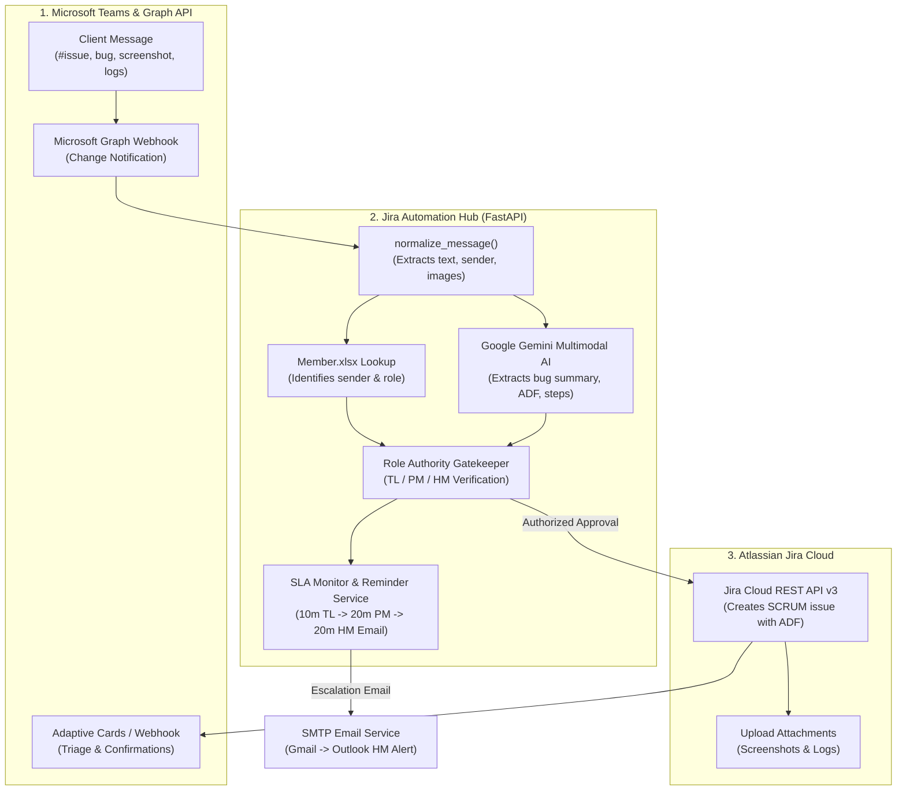

# Jira Automation Hub — Complete Project Master Guide & Specification

> **Comprehensive Reference for Architecture, Data Flows, User Identity, Approval Hierarchy, Jira Integration & Operational Workflows.**

---

## 📌 Table of Contents

1. [Executive Summary & Purpose](#1-executive-summary--purpose)
2. [End-to-End System Architecture](#2-end-to-end-system-architecture)
3. [Message Processing & AI Extraction Pipeline](#3-message-processing--ai-extraction-pipeline)
4. [User Identity, Roles & The Single Source of Truth (SSOT)](#4-user-identity-roles--the-single-source-of-truth-ssot)
5. [Jira Creator vs. Reporter Mechanics (How Identity Works)](#5-jira-creator-vs-reporter-mechanics-how-identity-works)
6. [3-Stage SLA Follow-Up & Human-in-the-Loop Gating](#6-3-stage-sla-follow-up--human-in-the-loop-gating)
7. [Atlassian Jira Cloud Integration (REST API v3 & ADF)](#7-atlassian-jira-cloud-integration-rest-api-v3--adf)
8. [Complete `.env` Configuration Reference](#8-complete-env-configuration-reference)
9. [Project Directory & File Structure](#9-project-directory--file-structure)
10. [How to Run, Test & Operate the System](#10-how-to-run-test--operate-the-system)
11. [Troubleshooting & Frequently Asked Questions](#11-troubleshooting--frequently-asked-questions)

---

## 1. Executive Summary & Purpose

In software engineering support environments, clients report bugs, errors, and task requests in Microsoft Teams chats and channels. Manually copying chat messages, transcribing screenshots, and opening Jira tickets is slow and error-prone.

**Jira Automation Hub** is an autonomous Python/FastAPI service that:
1. **Listens 24/7** to Microsoft Teams chats and channels via **Microsoft Graph Webhook change notifications**.
2. **Analyzes incoming messages & attachments** using **Google Gemini Vision Multimodal AI** to automatically extract structured issue specifications (observed behavior, expected behavior, steps to reproduce, and suggested developer assignees).
3. **Gates ticket creation behind human approval**: No ticket is created without authorization from a verified Team Lead (Level 1), Project Manager (Level 2), or Higher Management (Level 3).
4. **Enforces a 3-Stage SLA timeline**: If a message sits unaddressed, it automatically reminds the TL, escalates to the PM on Teams, and sends an urgent email alert to Higher Management.
5. **Creates formatted Jira issues** in **Atlassian Jira Cloud** using native REST API v3 with rich Atlassian Document Format (ADF) and uploads screenshots/attachments directly to the ticket.

---

## 2. End-to-End System Architecture



---

## 3. Message Processing & AI Extraction Pipeline

### 3.1 Webhook Notification Handling
* **Endpoint**: `/webhooks/teams` handles Graph API change notifications.
* **Handshake Validation**: When Microsoft Graph registers a webhook, it sends a validation token query string; the server immediately returns `200 OK` with the plain token string.
* **Notification Processing**: The payload contains the chat/channel resource URI and message ID. The engine queries Microsoft Graph (`GET /chats/{chat_id}/messages/{message_id}`) to retrieve the full message object.

### 3.2 Message Normalization (`normalize_message`)
Implemented in `src/services/message_service.py`:
* **Body Sanitization**: Cleans HTML while preserving code blocks (`<pre><code>`), blockquotes (`<blockquote>`), and bullet points.
* **Attachment Extraction**: Detects uploaded file attachments and parses OneDrive/SharePoint links shared directly in chat text.
* **Sender Metadata**: Extracts Microsoft Entra user ID (`from.user.id`) and display name (`from.user.displayName`).

### 3.3 Google Gemini Multimodal AI Extraction (`ai_service.py`)
* Analyzes raw message text alongside attached screenshots (PNG, JPG, WEBP) or log files.
* Produces a structured JSON draft containing:
  * `summary`: Clean, professional bug or task title (e.g. `[Dashboard] Refresh button unresponsive`).
  * `issue_type`: Bug, Task, Story, or Support Request.
  * `priority`: Highest, High, Medium, Low.
  * `affected_module`: E.g., Authentication, Billing, Dashboard.
  * `observed_behavior` & `expected_behavior`.
  * `steps_to_reproduce`: Array of step-by-step instructions.
  * `evidence`: Screenshots, logs, or error codes referenced.
  * `suggested_assignee`: Best developer matched by specialty from `Member.xlsx`.

---

## 4. User Identity, Roles & The Single Source of Truth (SSOT)

All user identities, role permissions, developer specialties, and escalation hierarchies are stored in **`Member.xlsx`** (located in the shared OneDrive folder or local `data/Member.xlsx`).

### 4.1 Role Hierarchy & Permissions

| Role | Hierarchy Level | Can Approve Tickets? | Responsibilities |
| :--- | :---: | :---: | :--- |
| **CLIENT** | Level - | ❌ No | Reports issues, logs, and feature requests. |
| **DEVELOPER** | Level - | ❌ No | Receives assigned Jira issues; works on code/fixes. |
| **UNASSIGNED** | Level - | ❌ No | Unverified sender; treated as Client by default. |
| **TL** (Team Lead) | **Level 1** | ✅ **Yes** | First-line technical triage; tagged after 10 min silence. |
| **PM** (Project Manager)| **Level 2** | ✅ **Yes** | Primary operational approver; escalated after 20 min. |
| **HM** (Higher Management)| **Level 3** | ✅ **Yes** | Final escalation authority; receives emergency email after 20 min. |

### 4.2 Dynamic Sender Role Resolution
Implemented in `src/services/sender_service.py`:
1. Checks `Member.xlsx` matching `user_id` (Microsoft Entra GUID) or `display_name`.
2. Reads the member's assigned role and approval permissions.
3. If not found in `Member.xlsx`, falls back to GUIDs configured in `.env` (`TEST_CLIENT_USER_ID`, `TEST_PM_USER_ID`).
4. Any unlisted sender defaults safely to `UNASSIGNED` (Client permissions, cannot self-approve).

---

## 5. Jira Creator vs. Reporter Mechanics (How Identity Works)

### 5.1 Why Tickets Originally Appeared Under "Dhruv dobariya"
1. **Jira API Token Owner**:
   * An Atlassian API token belongs to an individual Atlassian account (`dhruv.d.kombee@gmail.com`), not to a project.
   * In Jira Cloud, the **`creator`** field is a locked audit stamp indicating which account's credentials physically called the REST API.
2. **Teams Message Sender**:
   * During initial testing, messages sent in Teams originated from Dhruv's Microsoft Teams account.
   * The system dynamically read the sender as "Dhruv dobariya" and placed that name into the ticket description.

### 5.2 Jira Identity Fields Comparison

| Field in Jira | What It Means | Is It Dynamic in This System? |
| :--- | :--- | :--- |
| **`Reporter`** | The person who reported the issue. | **100% Dynamic**: Extracted from Teams sender and placed in the ticket ADF callout (`Reporter: Sender Name`). |
| **`Assignee`** | The specialist developer working on the issue. | **100% Dynamic**: Resolved from AI recommendation or PM override to an Atlassian `accountId`. |
| **`Approved By`** | The manager who authorized ticket creation. | **100% Dynamic**: Captured from the emoji reaction or card click (`PM Musaib Khan`, `TL Yash Kalkani`, etc.). |
| **`Creator`** | The technical account owning the API token. | **System-Enforced**: Locked by Atlassian Cloud to the API token user (`dhruv.d.kombee@gmail.com` or dedicated service bot). |

---

## 6. 3-Stage SLA Follow-Up & Human-in-the-Loop Gating

To prevent premature or bot-spammed tickets, creation is gated behind explicit human approval:

```
Message Arrives (Client)
   │
   ├─► [0 - 10 min]  Awaiting initial Team Lead acknowledgment
   │
   ├─► [10 min]     Stage 1: Bot tags Team Lead (TL) in Teams
   │
   ├─► [20 min]     Stage 2: Bot escalates to Project Manager (PM) on Teams
   │
   └─► [20 min]     Stage 3: Urgent SMTP Email sent to Higher Management (HM)
```

### 6.1 Two Ways to Approve a Ticket
1. **Emoji Reaction in Teams**:
   * Any authorized TL, PM, or HM reacts to the message with **`🎟️`**, **`🎫`**, or **`👍`**.
   * The webhook detects the reaction, verifies the approver's role in `Member.xlsx`, and initiates ticket creation.
   * Reacting with **`❌`** declines ticket creation.
2. **Interactive Teams Adaptive Card / Web Dashboard**:
   * The bot posts an Adaptive Card into the Teams chat with buttons:
     * **Confirm & Create Jira Ticket**
     * **Reassign Specialist (Dropdown)**
     * **Decline Ticket**

---

## 7. Atlassian Jira Cloud Integration (REST API v3 & ADF)

Implemented in `src/services/jira_service.py`:

* **API Specification**: Atlassian Jira Cloud REST API v3 (`POST /rest/api/3/issue`).
* **Document Format**: Descriptions are rendered in native **Atlassian Document Format (ADF)**.
* **Zero Asterisks Guarantee**: Formatted markdown asterisks (`**bold**`) are cleanly stripped and translated into native ADF text marks (`"marks": [{"type": "strong"}]`).
* **Info Callout Header**: Every created ticket features a prominent top callout panel:
  * **Reporter**: `[Sender Name] ([Sender Role])`
  * **Approved By**: `[Approver Name] ([Approver Role])`
  * **Module**: `[Affected Module]`
  * **Priority**: `[Highest / High / Medium / Low]`
  * **Suggested Specialist**: `[Developer Name]`
  * **Source**: `Microsoft Teams Support Automation`
* **Direct Attachment Upload**: Uploads all screenshots and log files directly to Jira via `/rest/api/3/issue/{key}/attachments`.

---

## 8. Complete `.env` Configuration Reference

```env
# ============================================
# Microsoft Entra (Azure AD) Application
# ============================================
MICROSOFT_TENANT_ID=a81d1bed-4d3a-4d17-84fd-328b73a3fc60     # Directory (tenant) ID GUID
MICROSOFT_CLIENT_ID=26257db2-a1c6-43a8-a7bc-993912f487cf     # App registration Client ID GUID
MICROSOFT_CLIENT_SECRET=xtX8Q~elf9V...                         # App Client Secret value

# ============================================
# Microsoft Teams Configuration
# ============================================
TEAMS_CHAT_ID=19:c8c7d01f1cc24db4b04de10e93c865de@thread.v2  # Monitored Teams chat thread ID
TEAMS_TEAM_ID=                                                # Monitored Team ID GUID (if channel)
TEAMS_CHANNEL_ID=                                             # Monitored Channel ID (if channel)
TEAMS_WEBHOOK_URL=https://...powerplatform.com/...             # Incoming webhook for posting cards

# ============================================
# Fallback Role User IDs (Microsoft Graph GUIDs)
# ============================================
TEST_CLIENT_USER_ID=35e03956-1723-469c-b561-90f03fc566ed
TEST_PM_USER_ID=d7bc3c28-33d9-4973-816e-445d51556b8b
TEST_DEVELOPER_USER_ID=c5a63f53-cc7a-4c05-ac9a-77e6991bc974
ALLOW_SELF_APPROVAL=false                                     # If false, clients cannot approve

# ============================================
# Server & Webhook Ingress
# ============================================
PORT=3000                                                     # Local server port
WEBHOOK_PUBLIC_URL=https://your-domain.ngrok-free.dev         # Public HTTPS webhook URL
LOG_LEVEL=info                                                # debug, info, warn, error
DATABASE_PATH=C:/Users/Admin/.jira_automation/messages.db     # SQLite database path

# ============================================
# Google Gemini Multimodal AI
# ============================================
GEMINI_API_KEY_1=AQ.Ab8RN6JW...                               # Primary Gemini API key
GEMINI_API_KEY_2=                                             # Failover key (if key 1 throttled)
GEMINI_MODEL=gemini-3.5-flash-lite                            # Low-latency multimodal model

# ============================================
# Atlassian Jira Cloud Integration
# ============================================
JIRA_BASE_URL=https://dhruvdkombee.atlassian.net               # Jira instance URL
JIRA_EMAIL=dhruv.d.kombee@gmail.com                           # Atlassian user account email
JIRA_API_TOKEN=ATATT3xFfGF...                                 # Atlassian API token
JIRA_PROJECT_KEY=SCRUM                                        # Jira target project key
JIRA_DEFAULT_ISSUE_TYPE=Task                                  # Default issue type (Task / Bug)

# ============================================
# SLA Timers & Email Escalation
# ============================================
PM_FOLLOWUP_TIMEOUT_MINUTES=10                                # Silence before TL reminder
PM_EMAIL_TIMEOUT_MINUTES=15                                   # Silence before PM escalation
PM_REMINDER_TIMEOUT_MINUTES=10                                # Silence before HM email

# ============================================
# SMTP Email Escalation (Gmail -> Outlook Delivery)
# ============================================
SMTP_HOST=smtp.gmail.com                                      # SMTP server host
SMTP_PORT=587                                                 # SMTP port (587 for TLS)
SMTP_USER=dhruv.d.kombee@gmail.com                            # SMTP authenticated sender
SMTP_PASSWORD=dvzyskulhuucczbv                                # Google App Password
SMTP_FROM_EMAIL=Jira Automation Hub <dhruv.d.kombee@gmail.com># Displayed From address
SMTP_USE_TLS=true                                             # Enable STARTTLS
```

---

## 9. Project Directory & File Structure

```
Jira-Automation/
├── .env                              # Environment credentials & configuration
├── Member.xlsx                       # Single Source of Truth for team roster & SLA
├── run.py                            # Master all-in-one launcher (ngrok + server + subs)
├── pytest.ini                        # Pytest configuration & test options
├── README.md                         # Primary project documentation
├── docs/                             # Documentation assets & specifications
│   ├── PROJECT_MASTER_GUIDE.md       # This comprehensive master manual
│   ├── PRODUCTION_IMPLEMENTATION_PLAN.md # Cloud deployment & production architecture
│   ├── Jira-Automation-Plan.pdf      # Original business plan & requirement PDF
│   └── Jira-automation-architecture.png # System architectural diagram
├── src/
│   ├── app.py                        # FastAPI application instance & routing
│   ├── config.py                     # Strongly-typed Pydantic configuration parser
│   ├── database.py                   # SQLite schema initialization & connection pool
│   ├── graph_client.py               # Microsoft Graph API asynchronous client
│   ├── logger.py                     # Structured JSON logging utility
│   ├── tunnel.py                     # Ngrok tunnel launcher & URL updater
│   ├── repositories/
│   │   └── message_repository.py     # SQLite persistence for messages & tickets
│   ├── routes/
│   │   ├── webhooks.py               # Graph API change notification receiver
│   │   ├── approvals.py              # Interactive card approval & decline endpoints
│   │   ├── dashboard.py              # Live web management dashboard
│   │   └── health.py                 # Health check & uptime diagnostic endpoints
│   └── services/
│       ├── ai_service.py             # Google Gemini Vision LLM ticket parser
│       ├── jira_service.py           # Atlassian Jira Cloud REST API v3 & ADF engine
│       ├── member_sync_service.py    # Member.xlsx sync & team roster resolver
│       ├── message_service.py        # Central message normalization & dispatch
│       ├── reminder_service.py       # 3-tier SLA monitor & escalation background loop
│       ├── email_service.py          # SMTP email alert dispatcher (Gmail -> Outlook)
│       ├── sender_service.py         # Role identification & approval validator
│       └── teams_notifier.py         # Adaptive Card builder & Teams webhook poster
└── tests/                            # Unit & integration test suites
```

---

## 10. How to Run, Test & Operate the System

### 10.1 Starting the Complete System
Run the all-in-one launcher:
```bash
python run.py
```
This automatically:
1. Validates all `.env` credentials.
2. Synchronizes the local database cache with `Member.xlsx`.
3. Starts the ngrok secure tunnel (if configured).
4. Verifies or automatically renews the Microsoft Graph webhook subscription.
5. Launches the FastAPI server on `http://localhost:3000`.
6. Starts the background SLA reminder and escalation loop.

### 10.2 Running Unit & Integration Tests
```bash
python -m pytest tests/test_jira_service.py
python -m pytest tests/test_role_authority_gate.py
python -m pytest tests/test_comprehensive_workflow.py
```

### 10.3 Accessing the Live Management Dashboard
Navigate to:
```
http://localhost:3000/dashboard
```
The dashboard provides a real-time view of:
* Active Microsoft Graph webhook subscription health.
* Inbound message log with sender roles, AI ticket drafts, and approval states.
* Created Jira issue links and direct browse URLs.
* Team roster and specialty breakdown from `Member.xlsx`.

---

## 11. Troubleshooting & Frequently Asked Questions

### Q1: Why does Jira show "Dhruv dobariya" as the creator?
* **Answer**: The Atlassian API token in `.env` is registered under `dhruv.d.kombee@gmail.com`. Atlassian permanently locks the `creator` field to the account owning the API token. To change this, use a dedicated bot service account (e.g. `automation@kombee.com`) for the token. The actual person who reported the issue is dynamically recorded in the ticket's top info panel as the **Reporter**.

### Q2: How does the system know who sent a message?
* **Answer**: Microsoft Graph API provides the sender's `displayName` and `id` in the message payload (`from.user`). The system matches this against `Member.xlsx` to determine whether they are a Client, Developer, Team Lead, or Project Manager.

### Q3: What happens if Microsoft Graph subscription expires?
* **Answer**: The background worker in `graph_client.py` monitors the subscription expiration time and automatically calls `async_renew_subscription()` every 15 minutes, ensuring uninterrupted 24/7 listening.

### Q4: What if Jira returns "Issue type 'Bug' not found"?
* **Answer**: In `jira_service.py`, if a project (like a default SCRUM board) does not have a "Bug" issue type enabled, the engine automatically catches the error and retries creation with the project's configured `JIRA_DEFAULT_ISSUE_TYPE` (`Task`).
